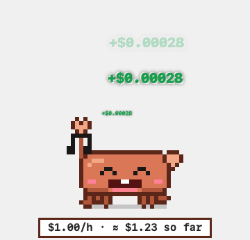
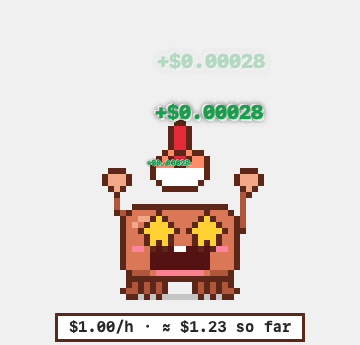
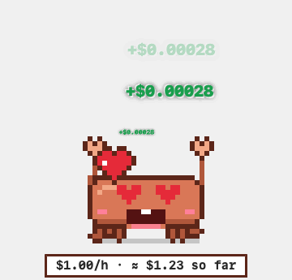
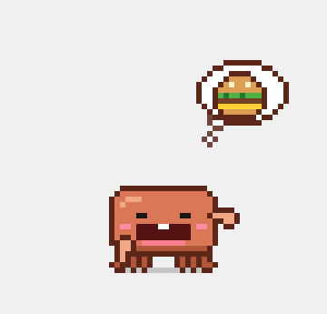

# Babel UI for macOS (optional)

A small native app that wraps the panel. It puts an icon in the menu bar and shows the panel in its
own window, so you don't need a browser tab. It is an optional extra: `server.py`, the page and the
`babel-ui` command work exactly as before.

## What it does

- **On launch** it checks `http://127.0.0.1:<port>/`. If a server already answers (for example one
  started with `babel-ui`), the app uses it. If nothing answers, it starts `.venv/bin/python -u server.py`
  in this checkout and appends its output to `~/Library/Logs/babel-ui.log`, like `babel-ui` does.
- **On quit** it stops only a server it started itself. The shared ssh connection is never closed.
- **Window**: the panel in a WKWebView. Terminal tabs (WebSocket), copy and paste, uploads and the
  page's `confirm()`/`prompt()` dialogs all work. Downloads go to `~/Downloads`, and a banner offers
  *Show in Finder*. Other sites open in the default browser. If you close the window, the page and
  its terminals keep running in the background. The Dock icon only shows while the window is open.
- **Menu bar**:
  - server status, a jobs line and a GPU line ("Jobs: 2 running · 1 pending", from `/api/queue` every 30 s)
  - Open Panel
  - Open in Browser
  - Restart Server…: asks first. If the server was started outside the app, it says so before
    stopping it.
  - Show Server Log
  - Launch at Login (`SMAppService`)
  - Quit
- If macOS starts the app at login, it stays in the menu bar without opening the window.

## The GPU crab (optional)

 
 

A small pixel-art crab, in the style of Claude's mascot, lives on your screen. It is an ordinary window
that other windows can cover.

- **While your running jobs hold GPUs**, it takes turns dancing, singing, eating, lifting weights and
  juggling a ball, and sometimes runs across the screen.
  - Every 2 s a green `+$…/s` pops out of its head: roughly what one second of those GPUs would cost
    to rent in a cloud.
  - A caption under it shows `$/h` and "so far", counted from each job's start.
  - Babel itself doesn't bill anyone; this is for fun.
- **With no GPUs**, it's hungry: mouth wide open, poking a claw into it, dreaming of food. It also
  naps and wanders around.
- **Drag it** to pick it up, and it panics. **Click it** to open a menu:
  - feed it, play, work out, dance, sing, run or nap
  - **Ask Claude Code on Babel**: opens a terminal tab in the panel that starts `claude`, either on
    the login node or inside one of your running jobs (`srun --jobid … --overlap --pty`)
  - roam around the screen, keep the crab on top of other windows, open the panel, hide the crab

  If Claude Code isn't installed on the cluster, that terminal prints the one-line installer instead.
- **Turning it off:** use "Show GPU Crab" in the menu-bar menu.
- **Prices** are ballpark on-demand $/GPU-hour by type (`GPUUsage.swift`; unknown types count as $1/h).
  To override one:

  ```bash
  defaults write local.babel-ui.mac gpuPrices -dict-add l40s 1.2
  ```
- **Previews:** a Debug build run with `BABEL_UI_PET_PREVIEW=<dir>` renders every act to GIFs and
  contact sheets, then exits.

## Build

Needs Xcode 16 or newer, and runs on macOS 14 or newer. Run `./install.sh` in the project root first.

```bash
cd macos
./build.sh            # → build/Babel UI.app (Release, universal, ad-hoc signed)
./build.sh install    # also copies it to ~/Applications
```

You can also open `BabelUI.xcodeproj` in Xcode and press Run. No signing team, sandbox or
notarization is needed. "Launch at Login" works best from `~/Applications` or `/Applications`. If the
menu shows a dash (–) instead of a check, approve the app in System Settings → General → Login Items.

## Settings

Each setting is read from the app's environment first, then from
`defaults write local.babel-ui.mac <key> <value>`, then from the project's `.env`, and finally
falls back to the default:

| env var              | defaults key   | default                                    |
|----------------------|----------------|--------------------------------------------|
| `BABEL_UI_DIR`       | `babelUIDir`   | the checkout the app was built from        |
| `BABEL_UI_PORT`      | `port`         | `.env`, else 8765                          |
| `BABEL_UI_PYTHON`    | `python`       | `.env`, else `.venv/bin/python`            |
| `BABEL_UI_LOG`       | `logFile`      | `~/Library/Logs/babel-ui.log`              |
| `BABEL_UI_DOWNLOADS` | `downloadsDir` | `~/Downloads`                              |

Every other variable in the app's environment (`BABEL_HOST`, …) is passed on to `server.py`.

## Testing without touching a running panel

Debug builds contain a self-test. It opens the panel and checks the page, a terminal WebSocket, the
JS dialogs, an optional download, an optional restart and the menu. It writes `results.json` plus
screenshots, then quits. Use a spare port, and a host name that matches no `Host` pattern in your
`~/.ssh/config`, so nothing reaches the cluster:

```bash
xcodebuild -project BabelUI.xcodeproj -scheme BabelUI -configuration Debug -derivedDataPath build/DerivedData build
```

```bash
BABEL_UI_PORT=8799 BABEL_HOST=selftest.invalid BABEL_UI_LOG=/tmp/bui-test/server.log BABEL_UI_DOWNLOADS=/tmp/bui-test/dl BABEL_UI_SELFTEST=/tmp/bui-test BABEL_UI_SELFTEST_QUIT=1 BABEL_UI_SELFTEST_RESTART=1 "build/DerivedData/Build/Products/Debug/Babel UI.app/Contents/MacOS/Babel UI"
```

`BABEL_UI_SELFTEST_DOWNLOAD=/api/download?path=…` also tests a download.
